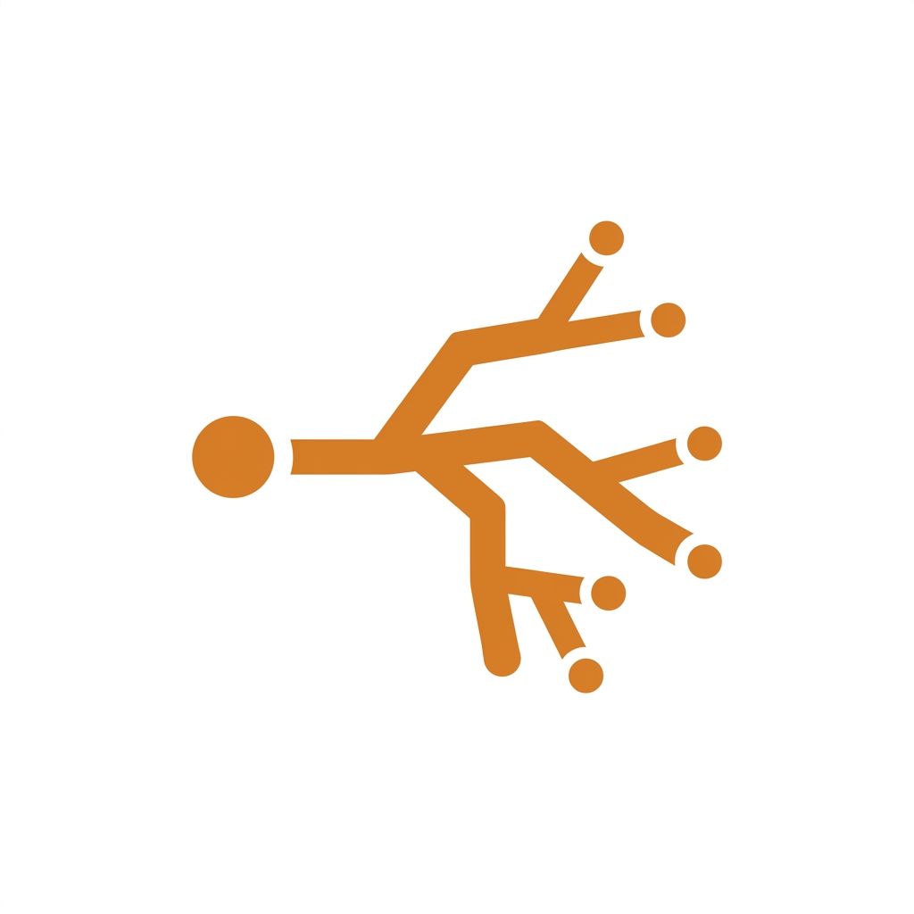

  

<h1 align="center">Juli OS</h1>

<b>The layered agent OS — adopt at your altitude.</b>

  
  
  

Juli OS is an open ladder of **independently usable layers** for building trustworthy AI agent systems. Grab a single layer for the problem you have today, or adopt the whole OS — every layer stands on its own.

## The ladder

| Layer | Package | What you get |
|---|---|---|
| **L0** Execution substrate | [`@juli-os/agents`](../agents)  | tmux-based agent session runtime with delivery confirmation and self-healing. Zero npm dependencies |
| **L1** Ledger | [`@juli-os/ledger`](../ledger)  | the append-only record of agent work — workflows, steps, case files, token usage. Zero npm dependencies (Node built-in SQLite) |
| **L2** Artifacts | [`@juli-os/artifacts`](../artifacts)  | hash-registered deliverables with provenance — content stays schema-free, metadata is the only structure |
| **L3** Gates | `@juli-os/gates` · upcoming | human approval flows with content-hash binding — nothing leaves without a sign-off |
| **L4** Routing | [`@juli-os/routing`](../routing)  | multi-agent dispatch decisions as pure functions, replayable offline |
| **L5** Orchestrator | `@juli-os/core` · upcoming | the full agent OS — composition root of the ladder |
| **L6** Surfaces | [`juli-os/ios`](../ios) · live · `@juli-os/web` · upcoming | iOS remote (SwiftUI), web cockpit, CLI |

## Surfaces today

The iOS remote is live and talking to a real engine — screenshots below were taken
against a seeded instance, not mockups (see the [tour](../ios#the-tour)):

  
  
  

## Principles

- **Adopt at your altitude** — every layer is useful alone; the whole is assembled, not required
- **Dependencies point strictly downward** — layers talk through ports, never around them
- **Humans stay in the loop** — approval gates wherever money or reputation is on the line
- **Zero-dependency first** — Node built-ins over packages whenever possible

## Status

Early days, moving bottom-up. **Three layers are live on npm** — [ledger](https://www.npmjs.com/package/@juli-os/ledger), [artifacts](https://www.npmjs.com/package/@juli-os/artifacts), [routing](https://www.npmjs.com/package/@juli-os/routing) — each installable on its own, all consumed by the engine we run in production. The [iOS remote](../ios) is the first surface out. Next up the ladder: gates (L3).

## Contact

- Open an issue in any repo under this org
- Email: [contact@juliasia.cn](mailto:contact@juliasia.cn)

---

Built by <b>Juli</b> · Apache-2.0

